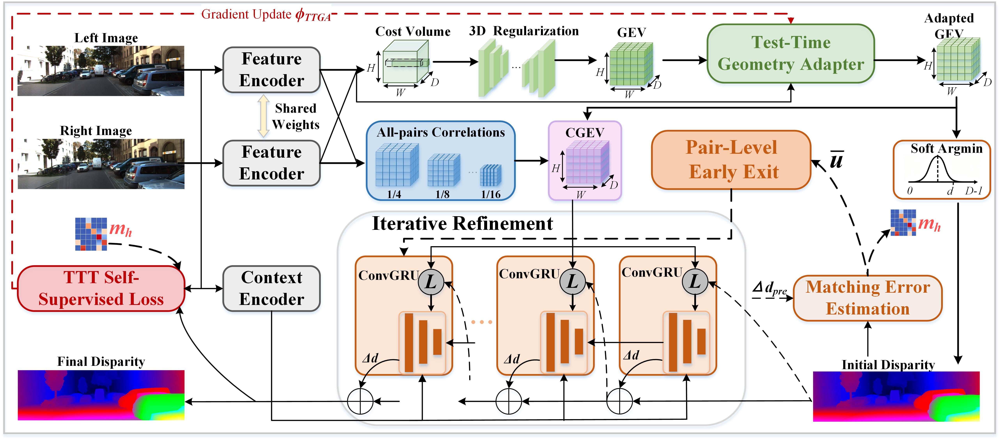

# Adapt, Then Refine: Test-Time Geometry Adaptation for Stereo Matching
## 📢 News
- **October 2026**: We officially release the full PyTorch implementation of **AdRe-Stereo** (Adapt, Then Refine: Test-Time Geometry Adaptation for Stereo Matching). This repository provides complete training pipelines, evaluation scripts, and benchmark submission tools for all five standard stereo matching datasets.


## 1.Method Overview


AdRe-Stereo proposes a novel **adapt-then-refine** paradigm for iterative stereo matching, addressing the core limitation that offline-learned geometry encoding parameters remain fixed across all inputs, leading to highly concentrated matching errors in weak-texture, repetitive-structure, occlusion, and disparity-boundary regions.

### Highlights
- Top-tier accuracy among **pure stereo matching methods** (no extra monocular depth priors) on five standard benchmarks.
- 19.1% relative EPE reduction over IGEV baseline on Scene Flow, with almost no parameter increase.
- Strong cross-domain generalization and cross-backbone transferability (verified on RT-IGEV).
- Flexible accuracy-efficiency configuration to fit different deployment requirements.

## 2.Performance Summary
We evaluate AdRe-Stereo on five widely used stereo matching benchmarks. The table below summarizes the main performance metrics of our method.

| Dataset | Metric | AdRe-Stereo (Best) |
| :--- | :--- | :---: |
| **Scene Flow** | EPE (px) ↓ | **0.38** |
| | Params (M) | 12.61 |
| | Runtime (ms, w/ early exit) | 312 |
| **KITTI 2012** | 3-noc error (%) ↓ | **0.85** |
| | 3-all error (%) ↓ | **1.03** |
| **KITTI 2015** | D1-all error (%) ↓ | **1.54** |
| | D1-fg error (%) ↓ | **2.52** |
| **Middlebury 2014 (half)** | Bad-2 (%) ↓ | **6.5** |
| **Middlebury 2014 (quarter)** | Bad-2 (%) ↓ | **5.6** |
| **ETH3D** | Bad-1 (%) ↓ | **3.3** |

> **Notes**:
> - Best results are obtained with 32 fixed refinement iterations and full TTGA test-time adaptation.
> - Runtime is measured on a single NVIDIA RTX 3090 GPU.
> - Cross-domain results on Middlebury and ETH3D are evaluated with models trained only on Scene Flow (no target-domain fine-tuning).

## 3.Create a virtual environment and activate it.

```Shell
conda create -n AdRe-Stereo python=3.8
conda activate AdRe-Stereo 
pip install -r requirements.txt
```


## 4.Datasets

- [Scene Flow](https://lmb.informatik.uni-freiburg.de/resources/datasets/SceneFlowDatasets.en.html)
- [KITTI 2012/2015](https://www.cvlibs.net/datasets/kitti/eval_scene_flow.php?benchmark=stereo)
- [Middlebury](https://vision.middlebury.edu/stereo/submit3/)
- [ETH3D](https://www.eth3d.net/datasets)

Default directory layout:

```text
datasets/
├── SceneFlow/
│   ├── FlyingThings3D/
│   ├── Monkaa/
│   └── Driving/
├── KITTI/
│   ├── KITTI2012/
│   └── KITTI2015/
├── Middlebury/
└── ETH3D/
```

Custom paths can be passed with `--sceneflow_root`, `--kitti_root`,
`--middlebury_root`, and `--eth3d_root`.

## 5.Training

Scene Flow:

```bash
CUDA_VISIBLE_DEVICES=0,1 python train_adre_stereo.py \
  --name adre_stereo_sceneflow \
  --logdir checkpoints/adre_stereo_sceneflow \
  --train_datasets sceneflow
```

KITTI 2012 and 2015:

```bash
CUDA_VISIBLE_DEVICES=0,1 python train_adre_stereo.py \
  --name adre_stereo_kitti \
  --logdir checkpoints/adre_stereo_kitti \
  --restore_ckpt checkpoints/adre_stereo_sceneflow/best.pth \
  --train_datasets kitti
```

## 6.Evaluation

```bash
python evaluate_adre_stereo.py \
  --restore_ckpt checkpoints/adre_stereo_sceneflow/best.pth \
  --dataset sceneflow
```

Supported datasets: `sceneflow`, `kitti2012`, `kitti2015`, `middlebury_H`,
`middlebury_Q`, and `eth3d`.

Use `--adaptive_refinement` to enable early exit:

```bash
python evaluate_adre_stereo.py \
  --restore_ckpt checkpoints/adre_stereo_sceneflow/best.pth \
  --dataset eth3d \
  --adaptive_refinement
```

## 7.KITTI submission

```bash
python submit_adre_stereo.py \
  --restore_ckpt checkpoints/adre_stereo_kitti/best.pth \
  --dataset kitti2015
```

Results and the submission archive are saved under `submissions/`.

## 8.Tests

```bash
python -m pytest -q
python -m compileall -q core train_adre_stereo.py evaluate_adre_stereo.py \
  submit_adre_stereo.py
```
